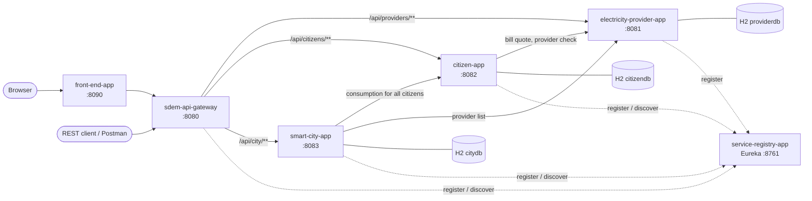
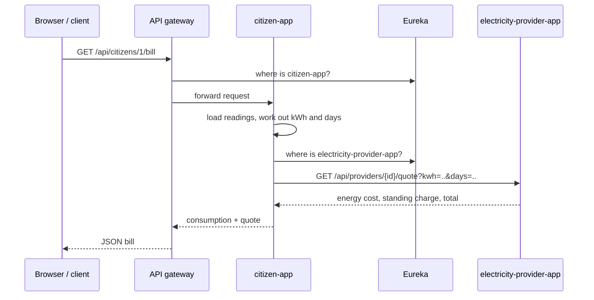

# Smart Electricity Microservice

[](https://github.com/AvinashSaha/Smart-Electricity-Microservice/actions/workflows/ci.yml)


**SDEM (Smart Distributed Electricity Management)** is a smart city electricity platform built as a set of
independent Spring Boot microservices. Households (citizens) submit smart meter readings, electricity
providers publish tariffs and price bills, and the city council gets live, city wide reports on consumption,
renewable energy share and CO2 avoided. A Thymeleaf web front end ties it all together, and every request
passes through an API gateway backed by a Eureka service registry.

This project was produced for **KF7014 Advanced Programming (Assessment 1)** at Northumbria University.

> **Want to run it?** See **[RUNNING.md](RUNNING.md)** for the full step by step run specification
> (prerequisites, build, start order, Docker, testing and troubleshooting).

---

## Contents

1. [Features](#features)
2. [Architecture](#architecture)
3. [Services](#services)
4. [Technology stack](#technology-stack)
5. [Project structure](#project-structure)
6. [API overview](#api-overview)
7. [How the services work together](#how-the-services-work-together)
8. [Business rules](#business-rules)
9. [Testing](#testing)
10. [Design decisions](#design-decisions)
11. [Future improvements](#future-improvements)
12. [Author and licence](#author-and-licence)

---

## Features

**Electricity providers**
- Register, update and deactivate energy suppliers with unit rate, standing charge and renewable mix
- Find the cheapest active provider
- Produce a bill quote for any amount of energy over any number of days

**Citizens (households)**
- Register households with a UK postcode, smart meter ID and chosen provider (validated against the provider service)
- Submit cumulative smart meter readings, with checks that readings never go backwards in value or time
- Calculate consumption between the first and latest reading
- Generate an itemised bill by calling the provider service
- Switch provider

**Smart city**
- Live city report: number of households, total and average consumption, renewable share and estimated CO2 avoided
- Consumption broken down by provider and by postcode district (for example NE1, NE4, NE6)
- Save report snapshots to track the city's figures over time

**Platform**
- Service discovery with Netflix Eureka, so services find each other by name
- Single entry point through Spring Cloud Gateway with client side load balancing
- Web front end (Thymeleaf) that only ever talks to the gateway
- Swagger UI / OpenAPI docs for every business service
- Consistent JSON error responses (RFC 7807 Problem Details)
- Health endpoints via Spring Boot Actuator
- Seed data so the system is useful the moment it starts
- Unit and integration tests, GitHub Actions CI, Docker Compose deployment

---

## Architecture



Each business service owns its own database (the *database per service* pattern), so no service reads
another service's tables. They share data only through REST calls, resolved by name through Eureka.

---

## Services

| Module | Port | Role |
|---|---|---|
| `service-registry-app` | 8761 | Eureka server. Every service registers here; the dashboard lists what is running. |
| `sdem-api-gateway` | 8080 | Spring Cloud Gateway. Routes `/api/**` to the right service using `lb://` load balancing. |
| `electricity-provider-app` | 8081 | Providers, tariffs, renewable mix and bill quotes. |
| `citizen-app` | 8082 | Households, smart meter readings, consumption and bills. |
| `smart-city-app` | 8083 | City wide reports and saved snapshots. |
| `front-end-app` | 8090 | Thymeleaf web UI: dashboard, providers, citizens, readings and bills. |

---

## Technology stack

| Area | Technology |
|---|---|
| Language | Java 17 |
| Framework | Spring Boot 3.3.5 (Web, Data JPA, Validation, Actuator, Thymeleaf) |
| Microservices | Spring Cloud 2023.0.3: Netflix Eureka, Spring Cloud Gateway, Spring Cloud LoadBalancer |
| Service to service calls | Spring `RestClient` with `@LoadBalanced` |
| Persistence | H2 in-memory database per service, Hibernate / JPA |
| API docs | springdoc-openapi 2.6 (Swagger UI) |
| Testing | JUnit 5, Mockito, AssertJ, Spring MockMvc |
| Build | Maven multi-module project |
| DevOps | Docker, Docker Compose, GitHub Actions |

---

## Project structure

```
Smart-Electricity-Microservice/
├── pom.xml                         Parent POM (versions, modules)
├── service-registry-app/           Eureka server
├── sdem-api-gateway/               API gateway (routes in application.yml)
├── electricity-provider-app/
│   └── src/main/java/com/sdem/provider/
│       ├── api/                    REST controller
│       ├── bean/                   Request / response DTOs
│       ├── entities/               JPA entities
│       ├── exception/              Custom exceptions + global handler
│       ├── repository/             Spring Data repositories
│       └── service/                Business logic
├── citizen-app/                    Same layered layout (+ config/ for RestClient)
├── smart-city-app/                 Same layered layout
├── front-end-app/
│   ├── src/main/java/com/sdem/web/ api/ (page controllers), bean/, client/ (GatewayClient)
│   └── src/main/resources/         templates/ (Thymeleaf), static/css/
├── docs/API.md                     Full endpoint reference
├── postman/                        Postman collection for every endpoint
├── scripts/                        start-all.sh / stop-all.sh helpers
├── Dockerfile                      One image recipe for any module (MODULE build arg)
├── docker-compose.yml              Runs the whole system
└── .github/workflows/ci.yml        Build and test on every push
```

Every business service follows the same layers: **api → service → repository → entities**, with **bean**
for DTOs so JPA entities are never exposed directly over HTTP.

---

## API overview

All endpoints are reachable through the gateway at `http://localhost:8080`. The full reference with
request and response examples is in **[docs/API.md](docs/API.md)**.

| Method | Path | Description |
|---|---|---|
| GET | `/api/providers` | List active providers |
| GET | `/api/providers/{id}` | Get a provider |
| GET | `/api/providers/cheapest` | Cheapest active provider |
| POST | `/api/providers` | Create a provider |
| PUT | `/api/providers/{id}` | Update a provider |
| DELETE | `/api/providers/{id}` | Deactivate a provider |
| GET | `/api/providers/{id}/quote?kwh=&days=` | Bill quote |
| GET | `/api/citizens` | List citizens |
| GET | `/api/citizens/{id}` | Get a citizen |
| POST | `/api/citizens` | Register a citizen |
| PUT | `/api/citizens/{id}` | Update a citizen |
| DELETE | `/api/citizens/{id}` | Delete a citizen |
| PUT | `/api/citizens/{id}/provider/{providerId}` | Switch provider |
| POST | `/api/citizens/{id}/readings` | Submit a meter reading |
| GET | `/api/citizens/{id}/readings` | List readings |
| GET | `/api/citizens/{id}/consumption` | Consumption summary |
| GET | `/api/citizens/{id}/bill` | Bill (priced by the provider service) |
| GET | `/api/citizens/consumption` | Consumption for every citizen |
| GET | `/api/city/summary` | Live city report |
| GET | `/api/city/providers` | Usage by provider |
| GET | `/api/city/districts` | Usage by postcode district |
| POST | `/api/city/snapshots` | Save a snapshot |
| GET | `/api/city/snapshots` | Snapshot history |

Swagger UI for each service: `http://localhost:8081/swagger-ui.html`, `:8082/swagger-ui.html`, `:8083/swagger-ui.html`.

---

## How the services work together

**Getting a citizen's bill** (`GET /api/citizens/1/bill`):



**Building the city report** (`GET /api/city/summary`): the smart city service fetches every citizen's
consumption from `citizen-app` and the provider list from `electricity-provider-app`, then aggregates totals,
renewable kWh, CO2 avoided, and the per provider and per district breakdowns.

If a downstream service is down, the caller returns **503 Service Unavailable** with a clear message instead of
an unhandled error, and the front end shows that message on the page.

---

## Business rules

| Rule | Where |
|---|---|
| Bill = (kWh × unit rate) + (days × standing charge), converted from pence to pounds, rounded half up to 2 dp | `ProviderService.calculate` |
| Renewable kWh = kWh × provider renewable % | `ProviderService.calculate`, `CityService` |
| Consumption = latest reading − first reading; days = elapsed time rounded up (minimum 1) | `CitizenService.summarise` |
| A new reading cannot be lower than, or earlier than, the previous reading | `CitizenService.addReading` |
| Email and meter ID must be unique; provider must exist in the provider service | `CitizenService.register` |
| Postcodes must be valid UK format and are stored normalised (`ne45ab` → `NE4 5AB`) | `CitizenRequest`, `CitizenService` |
| CO2 avoided = renewable kWh × grid carbon factor (0.207 kg/kWh, configurable) | `CityService` |
| Providers are soft deleted (deactivated) so old bills and reports still resolve | `ProviderService.deactivate` |

---

## Testing

```bash
mvn test
```

| Module | What is tested |
|---|---|
| `electricity-provider-app` | Bill calculation, validation, duplicates (unit); REST endpoints against seeded H2 (integration) |
| `citizen-app` | Consumption maths, reading rules, postcode normalising (unit); REST endpoints with the provider service mocked (integration) |
| `smart-city-app` | Aggregation, renewable share, CO2, district grouping (unit); REST endpoints with downstream calls mocked (integration) |
| `front-end-app` | Every Thymeleaf page renders, including the "gateway down" error state |
| `service-registry-app`, `sdem-api-gateway` | Application context starts |

The GitHub Actions workflow runs the full build and test suite on every push and pull request.

---

## Design decisions

- **Database per service.** Each service has its own H2 database, so services can change their schema and be
  deployed independently. Data crosses service boundaries only through APIs.
- **Service discovery instead of fixed URLs.** Services call `http://electricity-provider-app/...` and Eureka plus
  Spring Cloud LoadBalancer resolve it, so more instances can be started without code changes.
- **Gateway as the only public entry point.** The front end and external clients use one URL; routing, CORS and
  cross cutting headers live in one place.
- **DTOs (`bean` package) separate from entities.** The API contract does not leak the database model, and
  validation rules sit on the request objects.
- **`BigDecimal` for money and energy.** Avoids floating point rounding errors in bills.
- **Problem Details for errors.** Every service returns errors in the same RFC 7807 JSON shape, which the
  front end reads to show friendly messages.
- **Seed data.** Each service loads realistic sample data on start up, which makes demos and testing quick.

---

## Future improvements

- Replace H2 with PostgreSQL (one schema per service) for persistent storage
- Add Resilience4j circuit breakers and retries on service to service calls
- Secure the gateway with Spring Security and OAuth2 / JWT (citizen vs council roles)
- Publish meter readings as events (Kafka or RabbitMQ) instead of synchronous calls
- Centralised configuration (Spring Cloud Config) and distributed tracing (Micrometer Tracing + Zipkin)
- Time of use tariffs and monthly billing periods

---

## Author and licence

**Avinash Saha** · MSc Advanced Computer Science, Northumbria University

Released under the [MIT Licence](LICENSE).
