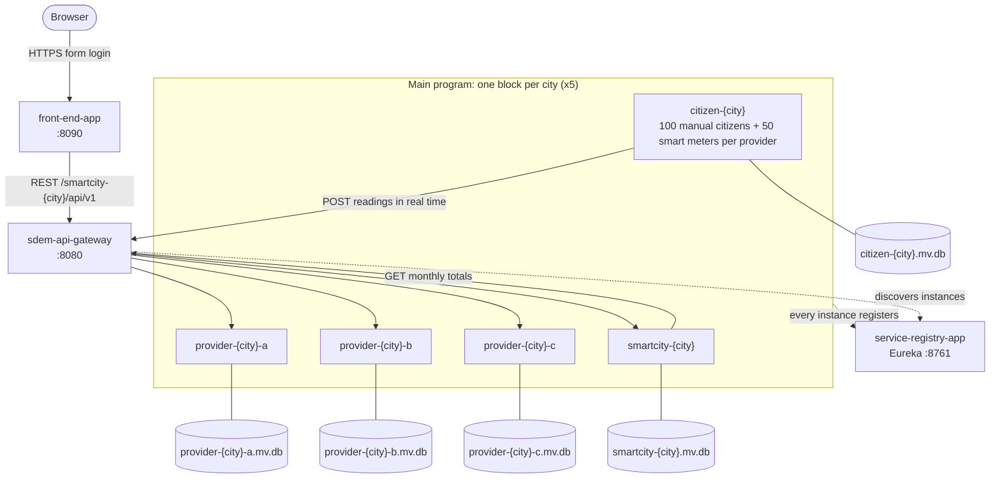
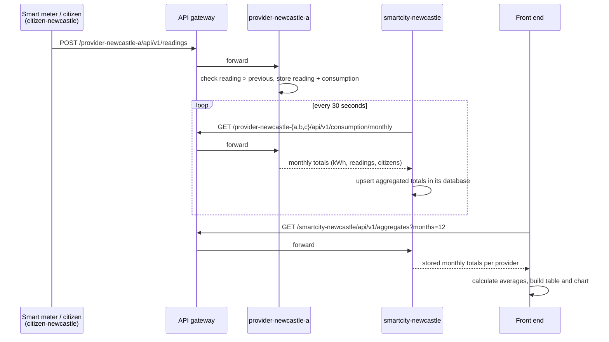
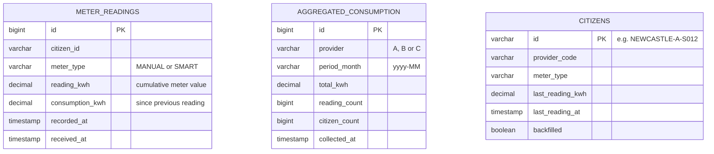

# Smart Electricity Microservice

[](https://github.com/AvinashSaha/Smart-Electricity-Microservice/actions/workflows/ci.yml)


A microservices-based application for **smart electricity management in the North East of England**.
Five pilot cities (Newcastle, Sunderland, Durham, Middlesbrough and Darlington) each run their own
Smart City system with three electricity providers (A, B and C). Citizens and smart meters send meter readings
to their provider in real time, each city collects and aggregates its providers' data, and a secure web
dashboard brings every city together into one view of the region.

Built for **KF7014 Advanced Programming** (Northumbria University), covering both parts of the brief:

| Part of the brief | What is in this repository |
|---|---|
| Individual component: microservices | Citizen, Electricity Provider and Smart City microservices, API gateway, service registry, main program, unit test project, data folder |
| Group component: front end | Modular web application with authentication and user management, data tables per city and per provider, interactive monthly average charts, integration test project |

> **To run it, see [RUNNING.md](RUNNING.md)** (prerequisites, build, start order, Docker, demo accounts, testing and troubleshooting).
> The full API reference is in [docs/API.md](docs/API.md).

---

## Contents

1. [Architecture](#architecture)
2. [Projects in the solution](#projects-in-the-solution)
3. [How data flows](#how-data-flows)
4. [Front end (group component)](#front-end-group-component)
5. [Microservices (individual component)](#microservices-individual-component)
6. [Databases](#databases)
7. [APIs and versioning](#apis-and-versioning)
8. [Testing](#testing)
9. [Security, error handling and best practices](#security-error-handling-and-best-practices)
10. [Technology stack](#technology-stack)
11. [Design decisions and limitations](#design-decisions-and-limitations)
12. [Author, acknowledgements and licence](#author-acknowledgements-and-licence)

---

## Architecture



* **All communication between microservices goes through the API gateway.** The gateway discovers every
  registered instance in Eureka and exposes it as `/{service-id}/**`, for example
  `/provider-durham-b/api/v1/readings` or `/smartcity-newcastle/api/v1/aggregates`.
* **Every microservice instance has its own database file** in [`data/`](data).
* In total the running region has **25 microservice instances** (5 smart city, 15 provider, 5 citizen),
  plus the registry, the gateway and the front end.

---

## Projects in the solution

| Project | Type | Port(s) | Purpose |
|---|---|---|---|
| [`service-registry-app`](service-registry-app) | Eureka server | 8761 | Service discovery; every instance registers here |
| [`sdem-api-gateway`](sdem-api-gateway) | Spring Cloud Gateway | 8080 | Single entry point, routes `/{service-id}/**` to instances |
| [`electricity-provider-app`](electricity-provider-app) | Microservice | 81x1 to 81x3 | Receives readings in real time and stores them permanently |
| [`smart-city-app`](smart-city-app) | Microservice | 81x0 | Requests data from its providers, collates, aggregates and stores it |
| [`citizen-app`](citizen-app) | Microservice | 81x4 | Simulates smart meters (random readings in a range) and manual citizen entry |
| [`main-program`](main-program) | Launcher | | Runs the Smart City system: per city 1 smart city, 3 providers, 100 citizens and 50 smart meters per provider |
| [`unit-tests`](unit-tests) | Testing project | | Unit tests for all microservices (individual component) |
| [`front-end-app`](front-end-app) | Web application | 8090 | Modular dashboard UI (group component) |
| [`integration-tests`](integration-tests) | Testing project | | Integration tests of the UI and microservices working together (group component) |
| [`data`](data) | Data folder | | H2 database files with sample data from one run |

**Port blocks per city** (x = city number): Newcastle 8110 to 8114, Sunderland 8120 to 8124, Durham 8130 to 8134,
Middlesbrough 8140 to 8144, Darlington 8150 to 8154. In each block: +0 smart city, +1 provider A, +2 provider B,
+3 provider C, +4 citizens.

---

## How data flows



1. **Citizen microservice.** On the very first run every citizen and smart meter sends 12 months of history
   (one reading per month with seasonal variation). After that, every tick (30 seconds) each smart meter sends a
   new reading that is a random amount within the configured range higher than the last, and a random share of
   the manual citizens type in a new reading. Readings that are not higher than the previous one are rejected.
2. **Electricity Provider microservice.** Receives each reading at the moment it is sent (real time), validates it
   against the citizen's previous reading, works out the consumption since that reading and stores it
   permanently.
3. **Smart City microservice.** Every 30 seconds requests monthly totals from its three providers, collates them and
   stores the aggregated totals permanently. If a provider is down, the others are still collected and the
   provider's last stored figures remain available.
4. **Front end.** Requests the aggregated totals of each city and **calculates the averages on the fly**. No average
   is ever stored in a database.

---

## Front end (group component)

| Requirement | How it is met |
|---|---|
| User authentication and authorisation | Spring Security form login, BCrypt password hashing, CSRF protection, roles `ADMIN` and `USER`; admins can **create and delete users**; every user can **change their password** |
| In-memory user store | `InMemoryUserDetailsManager`, seeded with two demo users |
| Data view: table per city | `/cities/{city}`: one row per month, one column per provider, total, citizens and calculated average per citizen |
| Data view: table per provider | `/providers/{a,b,c}`: one row per month, one column per city |
| Visualisation: monthly average of each provider in each city | Line / bar chart on each city page (Chart.js) |
| Visualisation: monthly average of all cities | Region overview chart, one line per city plus a dashed "All cities" line |
| Averages calculated, not stored | `AverageCalculator`, `DataViewService`, `VisualisationService` |
| Modular UI | Reusable Thymeleaf fragments (`layout`, `table`, `chart`); one city module component serves every configured city; services split into data loading, data view and visualisation modules |
| RESTful communication with the microservices | `SmartCityClient` calls `GET /smartcity-{city}/api/v1/aggregates` through the gateway |
| Error handling | A city that is down is shown as "Unavailable" while the rest of the page still works; friendly 404 and error pages; form validation messages |
| No ready-made UI template | Hand written CSS ([`app.css`](front-end-app/src/main/resources/static/css/app.css)) |

**Pages:** sign in, region overview (KPIs, all cities chart, city cards), five city pages, three provider pages,
change password, and user management (admins only). The period selector switches between 3, 6 and 12 months;
charts can be switched between line and bar, and legend entries toggle series on and off.

---

## Microservices (individual component)

| Brief requirement | Implementation |
|---|---|
| Citizen microservice simulates smart meters (random data in a specified range) and manual citizen input; each reading more than the previous | `SimulationService`, `ReadingGenerator`, `CitizenRegistry`; manual entry API `POST /api/v1/citizens/{id}/readings`; ranges set in `citizen.yml` |
| Electricity Provider microservice receives data in real time | `POST /api/v1/readings`, stored immediately; one instance per provider per city |
| Data stored permanently | H2 file databases in `data/` (`ddl-auto: update`, so data survives restarts) |
| Smart City microservice requests, collates, aggregates and permanently stores data | `AggregationService` (scheduled and on demand), `AggregatedConsumption` entity |
| Main program: 1 smart city, 3 providers, 100 citizens and 50 smart meters per provider | `MainProgram` and `CityPlan` (all five cities, or `--cities=...`) |
| API gateway for communication between microservices | `sdem-api-gateway` with Eureka discovery; citizen and smart city services call providers only through it |
| Each microservice has its own database | One `.mv.db` file per instance |
| Error and exception handling | `@RestControllerAdvice` per service returning RFC 7807 Problem Details (400, 404, 422, 503) |
| Testing project with unit tests for all microservices | `unit-tests` (Mockito unit tests and MockMvc controller tests) |
| Data folder with sample data from one run | `data/` |
| No external APIs, no datasets | All data is generated by the simulation |

---

## Databases



* `METER_READINGS` lives in each **provider** database, `AGGREGATED_CONSUMPTION` in each **smart city** database
  (unique per provider and month) and `CITIZENS` in each **citizen** database. The databases are separate, so the
  relationships (a citizen's readings, a provider's monthly totals) are kept by id across services, not by foreign keys.
* The front end's users are held **in memory** only.

---

## APIs and versioning

Every microservice API is versioned under **`/api/v1`**, and the web application shows its own version (1.0.0) and
the API version it uses in the footer and at `/actuator/info`. Through the gateway:

| Service | Method and path | Purpose |
|---|---|---|
| Provider | `POST /provider-{city}-{p}/api/v1/readings` | Receive a reading |
| Provider | `GET /provider-{city}-{p}/api/v1/readings?citizenId=&limit=` | Latest readings |
| Provider | `GET /provider-{city}-{p}/api/v1/consumption/monthly?months=` | Monthly totals |
| Provider | `GET /provider-{city}-{p}/api/v1/summary` | All time totals |
| Smart city | `GET /smartcity-{city}/api/v1/aggregates?months=` | Stored monthly aggregates |
| Smart city | `GET /smartcity-{city}/api/v1/summary?months=` | Totals per provider and collection status |
| Smart city | `POST /smartcity-{city}/api/v1/aggregates/collect` | Collect now |
| Smart city | `GET /smartcity-{city}/api/v1/providers/status` | Last collection result per provider |
| Citizen | `GET /citizen-{city}/api/v1/citizens?provider=` | List citizens and meters |
| Citizen | `GET /citizen-{city}/api/v1/citizens/{id}` | One citizen |
| Citizen | `POST /citizen-{city}/api/v1/citizens/{id}/readings` | Manual entry, forwarded in real time |
| Citizen | `GET /citizen-{city}/api/v1/simulation/status` | Simulation counters |

Requests, responses and error codes are documented in [docs/API.md](docs/API.md); a Postman collection is in
[`postman/`](postman). Each microservice also serves Swagger UI at `/swagger-ui.html` on its own port.

---

## Testing

```bash
mvn verify
```

| Project | Kind | Covers |
|---|---|---|
| `unit-tests` | Unit (individual component) | Provider: monthly aggregation, reading validation, controller status codes. Smart city: collection, upsert, provider failure handling, summaries, routing. Citizen: generator ranges, always increasing readings, history, sender, registry (450 citizens per city), manual entry rules. Main program: options and port plan |
| `integration-tests` | Integration (group component) | Starts 3 providers, a smart city, a citizen simulation and the front end in one JVM, all talking over real HTTP: simulation to providers, real time manual entry, rejection of lower readings, aggregation, sign in, city and provider pages, a city being down, 404, role based access, create user, change password and delete user |
| `service-registry-app`, `sdem-api-gateway` | Smoke | Application starts |
| GitHub workflow *Sample data and end-to-end run* | End to end | Runs registry, gateway, main program for all five cities and the front end; checks data through the gateway and the UI; commits the sample databases |

---

## Security, error handling and best practices

* **Access control:** every page needs a signed in user; user management needs `ADMIN`; passwords are BCrypt hashed;
  CSRF tokens on every form; session fixation protection; Content Security Policy header.
* **Data protection:** citizens are identified by generated ids only (no names, addresses or other personal data);
  readings carry only what billing and planning need.
* **Error handling:** consistent Problem Detail JSON from every API, meaningful status codes, graceful degradation when
  a provider or city is down, retry on the next tick for the simulation.
* **Code quality:** layered packages in every service (`api`, `bean`, `client`, `config`, `entities`, `exception`,
  `repository`, `service`), DTOs separate from entities, constructor injection, immutable records for data,
  `BigDecimal` for energy values, Javadoc on public classes, `.editorconfig` for consistent formatting.

---

## Technology stack

| Area | Technology |
|---|---|
| Language | Java 17 |
| Microservices | Spring Boot 3.3.5, Spring Cloud 2023.0.3 (Netflix Eureka, Spring Cloud Gateway) |
| Persistence | Spring Data JPA, Hibernate, H2 file databases |
| Front end | Spring MVC, Thymeleaf, Spring Security, Chart.js 4 (bundled locally) |
| API docs | springdoc-openapi (Swagger UI) |
| Testing | JUnit 5, Mockito, AssertJ, Spring MockMvc, Java HttpClient |
| Build and delivery | Maven multi-module, Docker, Docker Compose, GitHub Actions |

---

## Design decisions and limitations

* **One codebase per microservice, many instances.** Provider, smart city and citizen are each one project, run as
  several instances with different settings (city, provider, port). This matches how the providers and cities
  would deploy the same software.
* **Main program runs instances inside one JVM.** Each instance is a separate Spring Boot application with its own
  port, database and registration; running them in one JVM keeps memory use reasonable on a laptop. In production each
  would be its own process or container.
* **Gateway routes come from discovery,** so adding a city needs no gateway change.
* **History on first run.** Monthly charts need months of data, so on the first run the simulation sends 12 months of
  readings with realistic seasonal variation, then continues in real time.
* **H2** was chosen because it is embedded (no database server to install) and stores each service's data in a single
  file that can be committed as sample data.
* **Limitations:** users are lost when the front end restarts (in-memory store, as the brief requires); service to
  service calls are not authenticated; the simulation is not a physical model of household demand.

---

## Author, acknowledgements and licence

**Avinash Saha**, MSc Advanced Computer Science, Northumbria University.

Generative AI (Claude, by Anthropic) was used to help write code and documentation in this repository, as permitted
by the module brief provided it is acknowledged.

Chart.js is included under the MIT licence (see `front-end-app/src/main/resources/static/js/vendor/`).
This project is released under the [MIT Licence](LICENSE).
